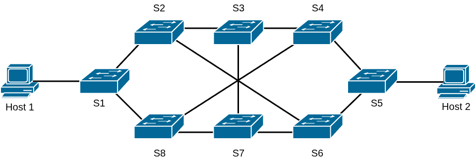

# sdn_dynamic_routing

## Publikacje
- #1 - I. E. Kamarudin and M. A. Ameedeen, "Dynamic Link Cost Weight Assignment for QoS-Based Routing in SDN," 2025 IEEE 9th International Conference on Software Engineering & Computer Systems (ICSECS), Pekan, Pahang, Malaysia, 2025, pp. 623-627, doi: 10.1109/ICSECS65227.2025.11279163.
  - Opis: Autorzy rozszerzają swój schemat routingu QoS, w którym koszt łącza był sumą ważoną dostępnej przepustowości, opóźnienia i strat pakietów ze stałymi wagami 2:1:1. Proponują dynamiczny dobór tych wag na podstawie klasy ruchu (DSCP), wykorzystania łącza i opóźnienia na łączu. W testach (Ryu, Mininet) koszt ścieżek wzrósł około dwukrotnie względem wag statycznych, lepiej odzwierciedlając przeciążenie. Nie zbadano jednak wpływu na parametry QoS end-to-end.
- #2 - M. Beshley, M. Seliuchenko, O. Panchenko and A. Polishuk, "Adaptive flow routing model in SDN," 2017 14th International Conference The Experience of Designing and Application of CAD Systems in Microelectronics (CADSM), Lviv, Ukraine, 2017, pp. 298-302, doi: 10.1109/CADSM.2017.7916140.
  - Opis: Autorzy proponują metrykę routingu dla SDN łączącą pięć parametrów: utratę pakietów, opóźnienie, przepustowość, jitter i obciążenie węzła. Parametry są agregowane metodą punktu idealnego z wagami, które kontroler dostosowuje do klasy ruchu. W symulacji sieci złożonej z 18 węzłów model obniżył średnie opóźnienie o 20–54% względem OSPF i EIGRP, zależnie od przyjętych wag. Wagi dobierane są ręcznie.

## Diagram sieci użytej w naszym projekcie

